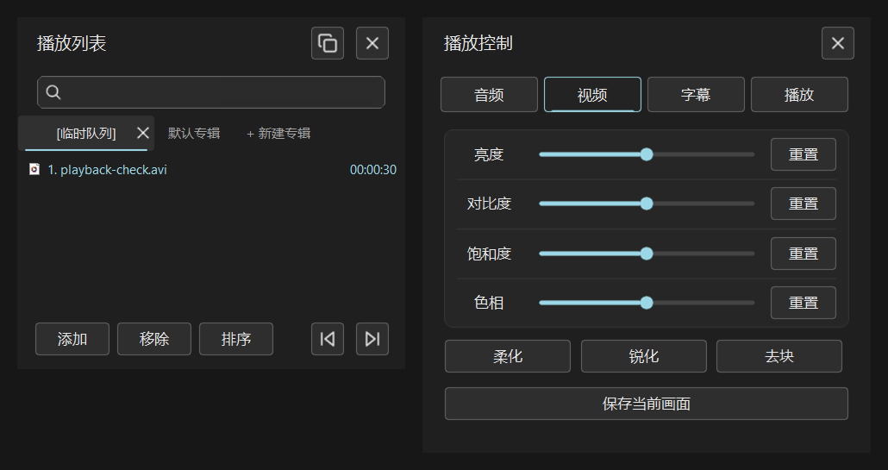

# Fluent Glass / PotPlayer

Windows 11 深色风格的 PotPlayer 皮肤生成器：Glass Orbit Logo、紧凑播放栏、带搜索框的播放列表、四页播放控制、圆角按钮，以及可选的启动页 Acrylic 毛玻璃。



本项目以**源码**发布。安装时从你本机已安装的 PotPlayer 读取 Default.dsf，生成只保留在本机的皮肤和预览副本；公开源码包不携带播放器、默认皮肤、生成的 DSF 或用户配置。

## 快速开始

需要 Windows 11、PotPlayer 64 位，以及 Python 3.10 或更高版本的 64 位版本。首次配置需要联网安装 Python 构建依赖；本机已验证 Python 3.13 和 3.14。若没有 Python，请先从 [Python 官网](https://www.python.org/downloads/windows/)安装。

1. 将源码 ZIP 解压到自己可写的文件夹。
2. 双击 **预览皮肤.cmd**。
3. 首次运行会自动查找播放器、创建本目录的 Python 环境、安装依赖并构建皮肤，然后打开独立预览。

只准备环境和生成皮肤时，双击 **安装皮肤.cmd**。重复运行会保留本地设置；源码或本机默认皮肤发生变化时重新构建。如果预览正在运行且有更新，会提示关闭后重新启动。

自动检测会检查本地安装记录、注册表、PATH、正在运行的播放器和常见安装目录。便携版或未检测到时，明确指定实际安装路径：

```powershell
.\预览皮肤.cmd -PlayerDirectory 'E:\Apps\PotPlayer'
```

指定 Python 或仅配置、不启动窗口：

```powershell
.\安装皮肤.cmd -PlayerDirectory 'E:\Apps\PotPlayer' -PythonExecutable 'C:\Python313\python.exe' -PrepareOnly
```

上述路径是示例，请替换为自己的路径。找不到播放器、Python 不兼容或依赖安装失败时，会显示具体原因；安装器不会替你下载播放器，也不需要修改系统播放器目录。

## 使用方式

**完整预览**：通过预览皮肤.cmd 启动。偏好和运行文件位于本目录 .runtime；预览使用播放器本地副本，保留系统播放器原有文件。毛玻璃只用于普通窗口的空闲启动页，播放媒体、拖动、最大化或全屏时恢复不透明。辅助窗口超出显示器工作区时会自动找回，手动拖动期间不会抢位置。

**关闭毛玻璃**：先关闭预览，然后运行以下命令。窗口位置管理仍然保留。

```powershell
.\预览皮肤.cmd -NoGlass
```

关闭预览播放器后，窗口管理脚本退出。卸载本地预览时，关闭窗口后删除本项目文件夹即可；如果另行手动安装了 DSF，也删除自己复制的文件。本项目不设置开机启动。播放器仍可能更新共享注册表中的机器元数据，因此预览不称为完全沙箱。

## 导入到自己的 PotPlayer 并设为常用皮肤

1. 双击 **安装皮肤.cmd**，完成本地构建。源码包内不预置 DSF，构建成功后会生成 `dist\FluentGlass.dsf`。
2. 找到自己平时使用的 PotPlayer 安装目录。可以右键播放器快捷方式，选择“打开文件所在的位置”；自动检测到的目录也记录在本项目 `.runtime\install.json` 的 `playerDirectory` 中。
3. 关闭播放器，将 `dist\FluentGlass.dsf` 复制到该安装目录的 `Skins` 子目录。比如播放器在 `E:\Apps\PotPlayer`，目标就是 `E:\Apps\PotPlayer\Skins\FluentGlass.dsf`。保留原来的 `Default.dsf`，不要覆盖它。安装目录受系统保护时，文件管理器可能要求管理员权限。
4. 启动自己的 PotPlayer，在播放画面上右键，打开“皮肤”菜单，选择 **FluentGlass**；如果菜单显示带扩展名的名称，则选择 **FluentGlass.dsf**。复制后没有出现时，完全退出播放器再启动。
5. 正常退出播放器后重新打开，确认仍使用 FluentGlass。PotPlayer 通常会保存最后选择的皮肤，无需把文件改名成 Default.dsf。如果启动后恢复默认皮肤，在 F5 设置的“基本 → 皮肤”相关选项中检查是否开启了启动时强制使用默认皮肤；具体名称随播放器版本而异。

这里是在自己的播放器中选择皮肤，与随附启动器的独立预览是两套偏好。恢复原皮肤时，在同一菜单选择默认皮肤即可；之后可删除自己复制的 FluentGlass.dsf。

### 为什么导入后窗口外沿仍是直角？

当前版本的 **DSF 单独导入不能保证真正的窗口圆角**。皮肤里的圆角按钮、分组和搜索框属于界面素材；整个窗口的外轮廓则由 PotPlayer 和 Windows 的窗口合成决定。当前皮肤使用自绘无系统边框窗口，DSF 本身没有调用 Windows 圆角 API 的能力。

随附启动器会额外运行 `tools/window_effects.py`，在 Windows 11 上请求 DWM 原生整窗圆角，作用于主窗口、播放列表和控制面板；最大化或全屏时主窗口按系统习惯恢复直角。只从普通 PotPlayer 的皮肤菜单加载 DSF，不会启动这个脚本，所以可能仍显示直角。

| 启动方式 | 皮肤界面 | 主动请求整窗圆角 | 空闲页毛玻璃 | 面板越界恢复 |
| --- | --- | --- | --- | --- |
| 自己的 PotPlayer 中选择 DSF | 有 | 无 | 无 | 无 |
| 预览皮肤.cmd | 有 | 有，Windows 11 普通窗口 | 有 | 有 |
| 预览皮肤.cmd -NoGlass | 有 | 当前不请求 | 无 | 有 |

因此，想获得本项目已验证的整窗圆角，请使用 **预览皮肤.cmd** 启动。当前窗口增强脚本只管理本项目的预览副本，不会自动附加到平时使用的 PotPlayer；仅替换 DSF 无法带上这些增强效果。系统是否自行添加圆角仍取决于 Windows 和播放器的窗口状态。

本地生成的 DSF 含有默认皮肤的兼容资源，其再分发权不由本项目 MIT 许可授予。

## 构建与测试

开发者可先运行安装脚本准备环境，再直接构建：

```powershell
.\安装皮肤.cmd -PrepareOnly
.\.venv\Scripts\python.exe tools\build.py
.\.venv\Scripts\python.exe -m unittest tests.skin_regressions -v
.\.venv\Scripts\python.exe tests\secondary_artifacts.py
.\.venv\Scripts\python.exe tests\source_release.py
.\.venv\Scripts\python.exe tests\installer_regressions.py
```

也可以为构建器直接指定本机 Default.dsf：

```powershell
.\.venv\Scripts\python.exe tools\build.py --default 'E:\Apps\PotPlayer\Skins\Default.dsf'
```

实际窗口测试需要本项目预览的进程 ID：

```powershell
.\.venv\Scripts\python.exe tests\native_regressions.py <PID> all
.\.venv\Scripts\python.exe tools\native_window.py <PID> --key 0x1B
.\.venv\Scripts\python.exe tests\window_bounds.py <PID>
```

native_regressions 的 all 在未加载媒体的空闲页运行。生成测试视频并加载后，可单独验证搜索和实际操作：

```powershell
.\.venv\Scripts\python.exe tools\make_test_video.py
.\.venv\Scripts\python.exe tools\native_window.py <PID> --drop qa\playback-check.avi
.\.venv\Scripts\python.exe tests\native_regressions.py <PID> test_playlist_search_filters_and_clear_restores_media
.\.venv\Scripts\python.exe tools\qa_secondary.py <PID> verify-controls
```

## 公开发布

使用源码导出工具生成公开包和新的干净目录：

```powershell
python tools\package_source.py --output .release\FluentGlass-source.zip --directory .release\FluentGlass
```

目标目录需要是新目录或空目录；不会覆盖已有文件。公开包采用允许清单，只包含源码、素材、许可证、文档和测试，并附 SHA256 文件清单。

**旧开发仓库曾包含默认皮肤资源，不能直接推送它的历史。** 如需发布到 GitHub，应在导出的干净目录中新建仓库；不要复制旧 .git，也不要上传本机生成的 src/、dist/ 或 .runtime。源码包不包含默认资源，不代表已经取得默认资源的再分发授权。

## 许可与已知范围

原创部分使用 [MIT 许可](LICENSE)；Lucide 图标保留原 ISC 许可。第三方范围和本地生成结果的权利边界见 [THIRD_PARTY_NOTICES.md](THIRD_PARTY_NOTICES.md)。本项目与 PotPlayer、Microsoft 无隶属关系。

实际界面与材质回归主要在 Windows 11、125% 缩放验证。100%、150%、200% 和不同显卡的完整视觉矩阵仍需扩展。默认设置对话框由 PotPlayer 自己绘制，界面文字当前主要为简体中文。窗口修复使用显示器工作区处理边界；关闭毛玻璃时也会运行。
